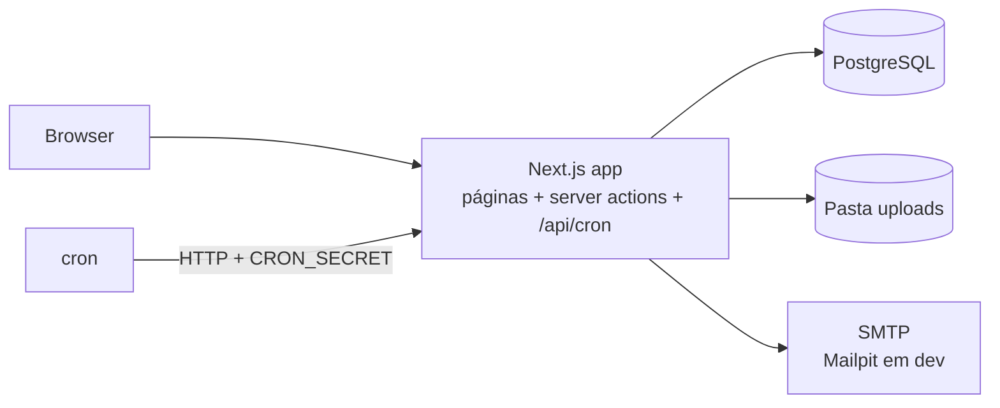

# miaUM — Perdidos e Achados da UMinho

> Lost something at UM? Just miaUM.

Aplicação web (mobile-first, PT/EN) para centralizar os objetos perdidos e encontrados nos campi da Universidade do Minho, incentivando a entrega nos pontos de entrega oficiais. Projeto independente; não usa a identidade visual oficial da UMinho.

## Arrancar em desenvolvimento

Requisitos: Node.js 22+ e Docker (Docker Desktop no Windows/macOS).

```bash
npm run setup   # instala, cria o .env, levanta Postgres + Mailpit, migra e corre o seed
npm run dev     # http://localhost:3000
```

- **Mailpit** (emails de login): http://localhost:8025
- **Utilizadores de teste** (login rápido em `/entrar`, só em desenvolvimento):

| Email | Perfis |
|---|---|
| `aluno@example.test` | Utilizador |
| `aluno2@example.test` | Utilizador |
| `staff@example.test` | Utilizador, Staff (ponto de exemplo de Gualtar) |
| `admin@example.test` | Utilizador, Administrador |

Também podes entrar por link mágico com qualquer email de `ALLOWED_EMAIL_DOMAINS`. O link aparece no Mailpit.

## Scripts

| Comando | Faz |
|---|---|
| `npm run dev` | Servidor de desenvolvimento |
| `npm run test` / `npm run test:coverage` | Testes unitários (Vitest) |
| `npm run lint` / `npm run typecheck` | Qualidade |
| `npm run db:up` / `npm run db:down` | Liga/desliga Postgres e Mailpit |
| `npm run db:migrate` | Cria/aplica migrações |
| `npm run db:reset` | Apaga a BD local, volta a migrar e a correr o seed |

## Arquitetura



Um único processo Next.js (App Router, TypeScript, Tailwind) com Prisma/PostgreSQL. Login por link mágico (Auth.js), com OIDC genérico opcional para o SSO institucional. As tarefas periódicas são rotas internas chamadas por cron. Sem Redis, filas externas ou S3.

## Dados

- As localizações em `prisma/seed/locations.ts` vêm de fontes públicas da UMinho e indicam a fonte e o estado (`confirmado`/`provisorio`) de cada local.
- Os pontos de entrega e horários são **dados de exemplo (PROVISÓRIO)** até haver a lista oficial.
- Os utilizadores de teste usam o domínio inventado `example.test`.
