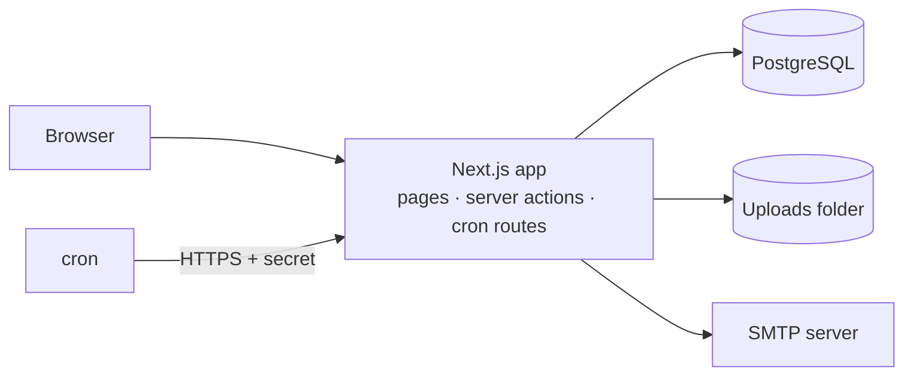

<div align="center">

# miaUM

**Lost and found for the University of Minho**

*Lost something at UM? Just miaUM.*


</div>

---

## Overview

Every day, students at the University of Minho send emails to report items they have lost or found on campus. It clutters inboxes and makes it hard to connect the person who lost something with the person who found it.

**miaUM** brings those reports into a single, mobile-first web app. It encourages finders to hand items in at an official drop-off point, suggests likely matches between lost and found reports, and protects everyone's privacy along the way.

> [!NOTE]
> miaUM is an independent student project. It is not an official University of Minho service and does not use the university's logo or visual identity.

## Principles

- **Complements the official process.** The app points people to official drop-off points. Ownership is confirmed in person, at the desk.
- **Minimal effort for finders.** Post the item and move on. No verification questions, no approving claims.
- **Private by default.** The public only sees where and when an item was found. The exact drop-off location and any contact are revealed only to the person who claims the item.
- **Simple to run.** A single Next.js app and a PostgreSQL database. No queues, no Redis, no Kubernetes: the load is around ten reports a day.
- **Zero cost.** Built entirely on free, open-source tools. Production needs only a Linux VM and an SMTP server.

## Features

| | Feature |
|:-:|---|
| ✅ | Sign-in by magic link, restricted to allowed email domains |
| ✅ | Optional generic OIDC provider, ready for institutional SSO |
| ✅ | Roles: user and administrator |
| ✅ | Portuguese (default) and English, light and dark mode |
| ✅ | Campus locations seeded from public University of Minho sources |
| ✅ | Lost and found reports, with search, filters and pagination |
| ✅ | Guided "I found something" flow that encourages official drop-off |
| ✅ | Photo uploads with client-side cropping/redaction and EXIF stripping |
| ✅ | "It's mine" reservations, revealing the drop-off place or finder's contact only to the claimant |
| ✅ | "My posts": lost, found and claimed items, closed by the claimant |
| 🚧 | Automatic matching and email notifications |
| 🚧 | Administration panel and moderation |
| 🚧 | Automatic deletion of every report after 30 days |

✅ available  ·  🚧 in progress

## Tech stack

| Layer | Technology |
|---|---|
| Framework | [Next.js](https://nextjs.org) 16 (App Router), React 19, TypeScript (strict) |
| Styling | [Tailwind CSS](https://tailwindcss.com) 4 |
| Database | PostgreSQL 16 with [Prisma](https://www.prisma.io) 7 |
| Authentication | [Auth.js](https://authjs.dev): email magic links and generic OIDC |
| Validation | [Zod](https://zod.dev) |
| Internationalisation | [next-intl](https://next-intl.dev) |
| Email | Nodemailer over SMTP ([Mailpit](https://mailpit.axllent.org) in development) |
| Testing | [Vitest](https://vitest.dev) |

## Getting started

### Prerequisites

- [Node.js](https://nodejs.org) 22 or later
- [Docker](https://www.docker.com) (Docker Desktop on Windows and macOS)

### Setup

```bash
git clone https://github.com/neptunedev77/miaUM.git
cd miaUM
npm run setup
npm run dev
```

`npm run setup` installs dependencies, creates a `.env` file with random secrets, starts PostgreSQL and Mailpit in Docker, applies migrations and seeds the database.

| Service | URL |
|---|---|
| App | http://localhost:3000 |
| Mailpit (sign-in emails) | http://localhost:8025 |

### Test accounts

In development, the sign-in page offers a one-click login for these seeded accounts. All emails use the reserved `example.test` domain.

| Email | Roles |
|---|---|
| `aluno@example.test` | User |
| `aluno2@example.test` | User |
| `admin@example.test` | User, Administrator |

You can also request a magic link for any address in `ALLOWED_EMAIL_DOMAINS`. The email arrives in Mailpit.

## Scripts

| Command | Description |
|---|---|
| `npm run dev` | Start the development server |
| `npm run build` | Build for production |
| `npm run lint` | Lint with ESLint |
| `npm run typecheck` | Type-check with TypeScript |
| `npm run test` | Run unit tests |
| `npm run test:coverage` | Run unit tests with coverage |
| `npm run db:up` / `db:down` | Start or stop PostgreSQL and Mailpit |
| `npm run db:migrate` | Create and apply migrations |
| `npm run db:reset` | Reset the local database and re-seed it |

Before committing, run the full check:

```bash
npm run lint && npm run typecheck && npm run test && npm run build
```

## Architecture



miaUM runs as **one Next.js process**. Scheduled jobs (sending emails, reverting stale claims, expiring reports) will be internal routes called by a small cron container, protected by a shared secret. Emails will go through a database outbox with retries, so none are lost if the SMTP server is down.

### Project structure

```
src/
  app/          Routes, pages and server actions
  components/   Shared UI components
  domain/       Pure business rules (no framework code)
  server/       Database, authentication, email and rate limiting
  i18n/         Locale configuration
messages/       Translations (pt, en)
prisma/         Schema, migrations and seed data
infra/          Docker Compose for local services
tests/          Unit tests
```

## Privacy

- Only a first name and an email address are stored for each user.
- Drop-off locations, private details and contact information are never shown publicly.
- Photo metadata, including GPS coordinates, is stripped on upload.
- Every report and its related data is deleted 30 days after publication. Only anonymous statistics are kept.

## Data sources

- **Locations** in `prisma/seed/locations.ts` come from public University of Minho sources, such as the [official campus maps](https://campi.uminho.pt). Each entry records its source and whether it is `confirmado` (confirmed) or `provisorio` (provisional).
- **Drop-off points and opening hours** are placeholder data, clearly marked as provisional, until the official list is available.

## Roadmap

- [x] **Phase 1 · Foundations.** Project setup, database, authentication, roles, i18n and base layout.
- [x] **Phase 2 · Core reports.** Lost and found forms, photos, search, reservations and "My posts".
- [ ] **Phase 3 · Matching and notifications.** Automatic matching and email notifications.
- [ ] **Phase 4 · Administration and production.** Admin panel, moderation, scheduled jobs, backups and deployment.

## License

A license has not been chosen yet. Until one is added, all rights are reserved.
